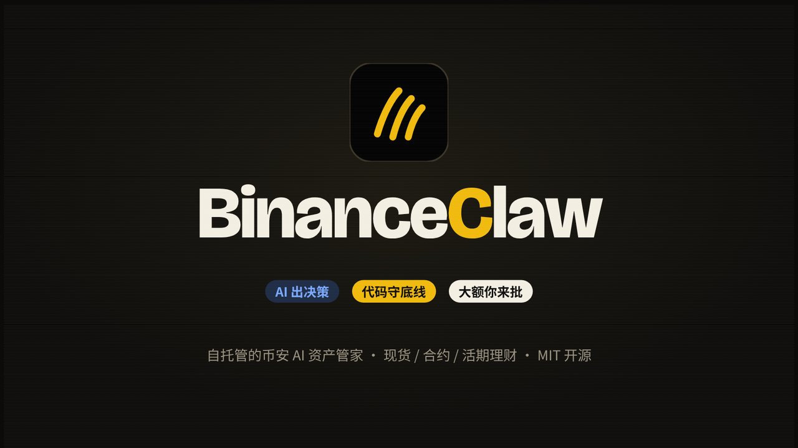
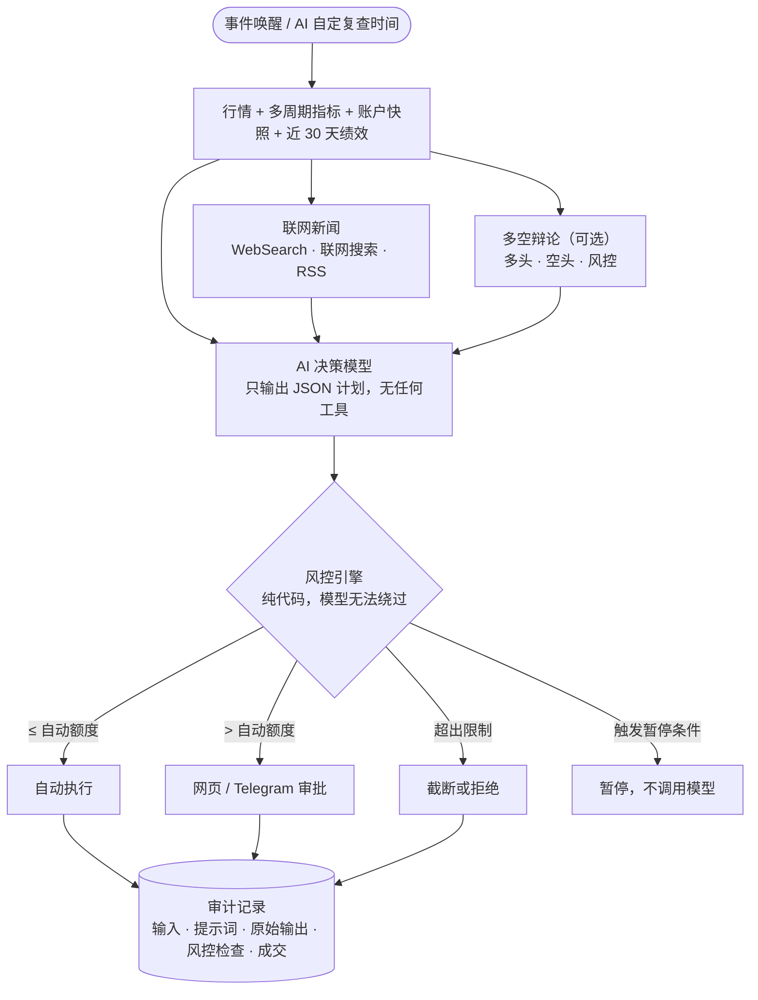

<div align="center">


# BinanceClaw

**让 AI 管理你的币安账户，风控由代码把关。**

AI 出决策 · 代码守底线 · 大额你来批

[](https://github.com/TypeThe0ry/BinanceClaw/actions/workflows/ci.yml)
[](LICENSE)
[](backend/pyproject.toml)
[](backend)
[](frontend)
[](docker-compose.yml)
[](docs/telegram.md)
[](https://github.com/TypeThe0ry/BinanceClaw/releases)
[](https://typethe0ry.github.io/BinanceClaw/)

[快速开始](#-快速开始) · [功能](#-功能) · [运行模式](#️-运行模式) · [工作原理](#️-工作原理) · [文档](https://typethe0ry.github.io/BinanceClaw/) · [更新日志](CHANGELOG.md) · [安全](SECURITY.md) · [English](#english)

</div>

> [!WARNING]
> 这是自托管的个人工具，**不是投资建议**。加密资产波动剧烈，AI 会犯错。先用模拟盘跑足够久，再决定是否开启实盘，并且只投入你能承受损失的资金。

## 🎬 两分钟看懂

<p align="center">
  <a href="https://typethe0ry.github.io/BinanceClaw/intro/"></a>
  <br/><sub>点击播放介绍动画（含音效）· 也可以下载 <a href="docs/intro/binanceclaw-intro.mp4">MP4</a></sub>
</p>

---

## 📸 界面

<p align="center">
  
  <br/><sub><b>资产</b> · 估值曲线（1日 / 7日 / 30天 / 90天 / 一年）、每个币的成本与目标区间、AI 动态</sub>
</p>

<p align="center">
  
  <br/><sub><b>现货</b> · K 线上标出 AI 的每笔成交和 AI 设置的价格提醒</sub>
</p>

> 截图来自作者的实盘账户，余额与持仓数量已遮挡。

## ✨ 亮点

<table>
<tr>
<td width="33%" valign="top">

### 🧠 任选模型
Claude 订阅（无需 API Key）、OpenAI、任意 OpenAI 兼容接口（DeepSeek、通义、Ollama、OpenRouter…）、Anthropic API，网页一键切换。

</td>
<td width="33%" valign="top">

### 🛡️ 代码级硬风控
模型只输出 JSON 计划、拿不到任何工具；每一笔都要过纯代码风控引擎，所有阈值都有不可突破的上下限。

</td>
<td width="33%" valign="top">

### ✅ 人在回路
超过自动额度的交易进入审批，可在网页或 Telegram 一键批准；高风险决策 AI 会先问你。

</td>
</tr>
<tr>
<td valign="top">

### 📈 现货 · 合约 · 理财
全市场现货（含代币化股票）、可选 USDⓈ-M 永续、闲置资产自动申购活期理财。

</td>
<td valign="top">

### 🧪 模拟盘优先
真实行情 + 虚拟资金，和实盘走完全相同的决策与风控流程；实盘需通过 API Key 权限准入检查。

</td>
<td valign="top">

### 🔍 全程可审计
每一轮的输入、提示词、原始输出、每条风控检查和成交都被记录，网页上能看到 AI 完整的"思考过程"。

</td>
</tr>
<tr>
<td valign="top">

### 🗣️ 多空辩论
多头、空头、风控三个角色先辩论 1–3 轮，再由决策模型权衡定夺；每个角色可以用不同的模型。

</td>
<td valign="top">

### 🏟️ 模型竞技场
多个模型各管一个虚拟账户，同一份实时行情比赛收益率，对比 BTC 持有，挑出最会交易的模型。

</td>
<td valign="top">

### 🔬 绩效与回测
夏普、回撤、胜率、盈亏比一目了然；用历史 K 线回放同一套 AI 决策与风控，无未来数据。

</td>
</tr>
</table>

## ⚙️ 工作原理



决策默认为 **AI 自主实时** 模式：AI 自己决定下次复查时间，价格波动、关键价位、止损止盈、成交、余额变化会实时唤醒它，并受最短/最长间隔和每日调用上限约束。详见 [AI 决策与风控](docs/decisions-and-risk.md)。

## 🧩 功能

<details open>
<summary><b>AI 决策</b></summary>

- **任选模型**：Claude 订阅、OpenAI、OpenAI 兼容接口、Anthropic API；可设备用模型，按任务分配大小模型，见 [模型](docs/models.md)。
- **代码算好的指标**：日线 / 4 小时趋势与 RSI、ATR 波动、MACD（金叉死叉与动能）、布林带（%B 与带宽）、量比、市场宽度；合约另有资金费率与持仓量变化。
- **自我复盘**：AI 每轮看到自己过去交易的胜率（`track_record`）和账户近 30 天绩效（`performance_30d`），回撤变大或连亏时主动收缩。
- **多空辩论（可选）**：多头、空头、风控辩论后由决策模型定夺，每个角色可用不同模型，见 [多空辩论](docs/debate.md)。
- **联网新闻**：每轮决策前默认让模型上网搜最新新闻，不限来源。Claude 订阅用 Claude Code 内置的 WebSearch / WebFetch，Anthropic API、OpenAI 用各自的联网搜索，其他模型读 RSS 新闻源；AI 同时看行情和消息面，风控不变，见 [联网新闻](docs/news.md)。
- **交易风格与观点**：短线 / 中期 / 长期，外加你对大盘和单币的看法；AI 有跨轮记忆，高风险决策会先问你。

</details>

<details open>
<summary><b>资金与分配</b></summary>

- **锁定资产**：AI 看不到、不能用；**投入预算**：限定 AI 可动用的资金。
- **AI 自主分配**：默认可交易全部现货资产，可选白名单或黑名单；自选资产固定入选，自动识别稳定币，AI 有跨轮记忆。
- **手动分配**：你定比例，偏离超过阈值自动再平衡；目标配置可以自己设、让 AI 生成，或用一句话让 AI 修改（应用前只是提案）。
- **交易风格**：短线 / 中期 / 长期，并可写下你的个人观点供 AI 参考。
- 详见 [资金管理与资产分配](docs/capital-and-allocation.md)。

</details>

<details open>
<summary><b>风控</b></summary>

- 币种白名单、单笔上限、每日笔数与金额上限、**每日自动执行总额**（防止拆单绕过审批）、稳定币下限、类别区间上限。
- 卖出默认关闭；免审批卖出有每日上限。
- BTC 7 日跌幅自动暂停、行情异常自动暂停、紧急停止。
- **风险预设**：保守 / 均衡 / 积极，一键切换，见 [风险预设](docs/risk-presets.md)。
- **危险设置二次确认**：改风控、资金、合约、理财等设置需服务端签发的确认令牌。

</details>

<details>
<summary><b>交易品种</b></summary>

- **全市场现货**：从币安现货全部资产（含代币化股票）里搜索选择，按币安分类（Layer 1 / Layer 2、Meme、AI、DeFi…）筛选；暂停交易的交易对恢复后自动可交易。
- **合约（可选）**：USDⓈ-M 永续，逐仓、杠杆上限、强制交易所止损、单笔亏损上限，开仓默认要审批，见 [合约](docs/futures.md)。
- **理财（默认开启）**：闲置资产自动申购活期产品（随时可赎回），买卖前自动赎回，见 [理财](docs/earn.md)。

</details>

<details>
<summary><b>绩效、回测与竞技场</b></summary>

- **绩效**：收益率、同期 BTC、年化收益与波动、最大回撤与回撤曲线、夏普 / 索提诺 / 卡玛；已平仓交易的胜率、盈亏比、每笔期望、连胜连亏，按币种汇总。
- **回测实验室**（绩效 › 回测）：选 1–8 个币、日期区间和决策间隔（4h / 12h / 1d），把历史 K 线逐轮回放给同一套提示词、模型和风控；每轮只看已收盘的 K 线、提示词不含日期；结果对比持有 BTC 和等权持有，附交易记录和每轮决策轨迹。
- **模型竞技场**：最多 8 个模型各管一个虚拟账户，同一时刻拿同一份行情和盘口并行决策，按收益率、超额 BTC、回撤、夏普、胜率排名，每轮决策可并排对比；永远不碰真实账户。
- 详见 [绩效与回测](docs/performance.md)、[模型竞技场](docs/arena.md)。

</details>

<details>
<summary><b>界面与通知</b></summary>

- **网页仪表盘**：总览、账户估值曲线（1日 / 7日 / 30天 / 90天 / 一年）、AI 决策流、审批、K 线与成交、对话、日报、设置；深色 / 浅色主题跟随系统，桌面和手机都能用，SSE 实时刷新。
- **盈亏与提醒**：平均成本法计算每个币的盈亏，并与「全买 BTC」对比；价格提醒可手动设，也可由 AI 设置。
- **Telegram**：审批按钮、成交与暂停通知、每日日报、定时汇总、免打扰，`/status /run /pause /resume /kill`，直接发文字和模型对话（只读），见 [Telegram](docs/telegram.md)。

</details>

## 🎛️ 运行模式

每个维度独立切换，任意组合；所有组合都走同一个代码风控引擎，模式只改变「什么时候决策、交易什么、谁来批准」。

| 维度 | 模式 | 默认 | 作用 |
|---|---|---|---|
| 交易模式 | **模拟盘** · 实盘 | 模拟盘 | 模拟盘用真实行情 + 虚拟资金、不下单，流程与实盘完全相同；实盘需通过 API Key 权限检查 |
| 资产分配 | **手动分配** · AI 自主分配 | 手动分配 | 手动：你定目标比例，偏离超过阈值自动再平衡；AI 自主：AI 自己选币定比例，范围可选全部资产 / 白名单 / 黑名单，范围外的持仓只卖不买 |
| 决策时机 | **AI 自主实时** · 固定间隔 | AI 自主实时 | 自主：AI 自定下次复查时间，价格波动、关键价位、止损、成交、余额变化实时唤醒；固定：每 N 分钟一轮 |
| 交易风格 | 短线 · **中期** · 长期 | 中期 | 决定持仓周期、关注的周期和复查间隔 |
| 风险预设 | 保守 · **均衡** · 积极 | 均衡 | 一键套用单笔 / 每日额度、稳定币下限、暂停线和决策频率 |
| 审批 | **正常审批** · 免审批（按时段 / 一直） | 正常审批 | 免审批只跳过「等你批准」，所有硬限制照常；卖出和合约开仓需另外勾选 |
| AI 提问 | **开** · 关 | 开 | 高风险决策先给你选项；超时可选不操作或按 AI 推荐执行 |
| 交易品种 | 现货 · 合约 · **理财** | 现货 + 理财 | 合约默认关闭、开仓默认要审批；理财把闲置资产申购活期、买卖前自动赎回 |
| 决策方式 | **单模型** · 多空辩论 | 单模型 | 辩论：三个角色辩论 1–3 轮后由决策模型定夺 |
| 联网新闻 | **模型联网搜索** · 新闻源 · 关 | 模型联网搜索 | 决策前让模型上网搜最新新闻，不限来源；模型不能联网时读 RSS |
| 通知 | **即时** · 定时汇总 · 免打扰 | 即时 | 审批、AI 提问和重大风险提醒始终立即推送 |

另有两个沙盒，永远不碰真实账户：**模型竞技场**（实时行情下多模型比赛）和**回测实验室**（历史行情回放）。完整说明和推荐组合见 [模式一览](docs/modes.md)。

## 🚀 快速开始

### Docker（推荐）

```bash
git clone https://github.com/TypeThe0ry/BinanceClaw.git && cd BinanceClaw
docker compose build
docker compose run --rm -it binanceclaw setup     # 设置网页密码、币安 Key、模型、Telegram（输入不回显）
docker compose run --rm binanceclaw doctor        # 自检
docker compose up -d                              # http://127.0.0.1:8686
```

默认只监听 `127.0.0.1`。想从手机访问，推荐 Tailscale（`tailscale serve --bg --tcp=8686 tcp://127.0.0.1:8686`），或在 `docker-compose.override.yml` 里加一个局域网地址，参考 `docker-compose.claude.yml.example`。

<details>
<summary><b>使用 Claude 订阅</b></summary>

二选一：
1. 在任意已登录的机器上运行 `claude setup-token`，把得到的 token 在 `setup` 里填入 `CLAUDE_CODE_OAUTH_TOKEN`；
2. 宿主机已登录 Claude Code 时，把 `~/.claude` 和 `~/.claude.json` 挂载进容器（见 `docker-compose.claude.yml.example`）。

决策调用以 `--tools ""`、`--strict-mcp-config`、空工作目录运行：模型拿不到任何工具，只能返回 JSON。

</details>

<details>
<summary><b>不用 Docker</b></summary>

```bash
cd backend && python3 -m venv .venv && .venv/bin/pip install -e .
cd ../frontend && npm ci && npm run build
cd ../backend && BINANCECLAW_DATA=../data .venv/bin/binanceclaw setup
BINANCECLAW_DATA=../data .venv/bin/binanceclaw serve      # --host / --port 可选
```

</details>

### 币安 API Key

在币安「API 管理」创建（建议用独立子账户）：

| 权限 | 设置 |
|---|---|
| 读取 | ✅ 开启 |
| 现货交易 | ✅ 开启 |
| IP 白名单 | ✅ 只填服务器的公网出口 IP |
| 提现 / 合约 / 杠杆 / 万向划转 / 内部划转 / 期权 | ❌ 全部关闭 |

不满足时，模拟盘照常可用，但「开启实盘」会保持锁定并列出原因。

如果你清楚风险、需要保留合约、杠杆或划转权限（例如同一把 Key 还给别的工具用），可以在设置页逐项勾选「允许保留」。BinanceClaw 本身不会调用这些接口；**提现和 IP 白名单永远强制检查，不能豁免。** 详见 [模拟盘与实盘](docs/live-mode.md)。

## 🔧 配置

网页分两页（都保存到 `data/settings.json`）：「配置」管 AI 怎么投资（分配方式、目标配置、资金、风控限额、风险预设、合约）；「设置」管系统（交易模式、AI 模型、决策节奏、理财、Telegram 推送、连接、已登录设备）。两页都支持搜索和分类跳转。

| 项 | 默认 | 说明 |
|---|---|---|
| 目标配置 | BTC 60%（50–70%）· ETH 5%（3–8%）· 美股代币 10%（5–15%）· 稳定币 25%（15–35%） | AI 的锚；区间上限由风控强制 |
| 单笔上限 / 自动执行上限 | $800 / $200 | 超过自动额度的进入审批 |
| 每日自动执行总额 | $400 | 防止把大单拆成多笔小单 |
| 每日笔数 / 总额 | 3 笔 / $2,400 | |
| 稳定币下限 | 15% | 买入后不得低于此比例 |
| BTC 7 日跌幅暂停线 | 25% | 触发后暂停，`/resume` 恢复 |
| 决策方式 | AI 自主实时 | 最短间隔 5 分钟、最长 240 分钟、每天最多 48 次调用 |
| 资产分配 | 手动分配 + 自动再平衡 | 偏离目标 5 个百分点时调回 |
| 多空辩论 | 关闭 | 开启后每轮多 3 × 轮数 次模型调用 |
| 联网新闻 | 开启，每 60 分钟刷新 | 搜索用轻量模型，中间的轮次复用上次结果 |
| 审批有效期 | 30 分钟 | |

密钥只放在 `data/.env`（权限 600），由 `binanceclaw setup` 写入，网页上只显示"已配置"。

## 📚 文档

在线阅读：**<https://typethe0ry.github.io/BinanceClaw/>**（也可以在网页右上角的 📖 里看，或直接浏览 [docs/](docs/README.md)）。

| 入门 | 进阶 | 参考 |
|---|---|---|
| [快速开始](docs/getting-started.md) | [AI 决策与风控](docs/decisions-and-risk.md) | [模型](docs/models.md) |
| [界面指南](docs/dashboard.md) | [多空辩论](docs/debate.md) · [联网新闻](docs/news.md) | [Telegram](docs/telegram.md) |
| [模式一览](docs/modes.md) | [资金管理与资产分配](docs/capital-and-allocation.md) | [常见问题](docs/faq.md) |
| [模拟盘与实盘](docs/live-mode.md) | [风险预设](docs/risk-presets.md) | [安全](SECURITY.md) |
| [审批](docs/approvals.md) | [合约](docs/futures.md) · [理财](docs/earn.md) | [更新日志](CHANGELOG.md) |
| | [绩效与回测](docs/performance.md) · [模型竞技场](docs/arena.md) | |

## 🏗️ 项目结构

```
backend/binanceclaw/
  exchange/   binance_spot.py · binance_futures.py · broker.py · futures_broker.py · stream.py
  brain/      providers.py · prompt.py · schema.py（严格 JSON 结构）· indicators.py · allocation.py · debate.py
  risk/       engine.py（硬限制，纯函数）· futures.py · gate.py（实盘准入）· rebalance.py
  core/       service.py（决策管道、执行、审批）· autopilot.py · earn.py · valuation.py · events.py
              metrics.py · analytics.py（绩效）· backtest.py（回测）· arena.py（竞技场）
  notify/     telegram.py · policy.py · charts.py
  api/        app.py（FastAPI，登录、REST、SSE）
  cli.py      serve · setup · doctor · password
frontend/     Vite + React + TypeScript + Tailwind + Framer Motion
docs/         使用文档（同时发布为 GitHub Pages 文档站，见 mkdocs.yml）
```

## 🛠️ 开发

```bash
# 后端
cd backend && .venv/bin/pip install -e ".[dev]"
.venv/bin/pytest -q && .venv/bin/ruff check .

# 前端
cd frontend && npm ci
npm run dev          # 代理到 127.0.0.1:8686
npm run typecheck && npm test
```

测试覆盖风控每条硬限制、对抗性的 AI 输出（卖出、非白名单、合约交易对、超额、拆单、多余字段、非 JSON）、审批的并发与过期、实盘准入、日志脱敏。CI 在每次推送时运行后端 lint 与测试、前端类型检查 / 测试 / 构建，以及 gitleaks 密钥扫描。

## 🔒 安全

威胁模型、密钥处理和漏洞报告方式见 [SECURITY.md](SECURITY.md)。

## 📄 License

[MIT](LICENSE) © TypeThe0ry

---

<a id="english"></a>

<details>
<summary><b>English</b></summary>

**BinanceClaw** is a self-hosted, AI-driven manager for your Binance account (spot, optional USDⓈ-M futures and flexible Earn).

- **Bring your own model**: Claude subscription via Claude Code CLI (no API key), OpenAI, any OpenAI-compatible endpoint, or the Anthropic API.
- **The model only plans**: it returns a strict JSON plan with no tools; a deterministic risk engine enforces hard limits it cannot bypass.
- **Human in the loop**: anything above the auto-execute limit needs your approval from the web dashboard or Telegram.
- **Paper first**: real market data with virtual funds, same pipeline as live; live mode is gated on API-key permission checks (withdrawals must be off).
- **Fully audited**: inputs, prompts, raw outputs, every risk check and every fill are recorded.
- **Bull/bear debate** (optional): bull, bear and risk seats argue for 1–3 rounds before the decision model writes the plan; each seat can use a different model.
- **Live news**: before each round the latest news is gathered (Claude Code's built-in WebSearch/WebFetch, Anthropic or OpenAI web search, or RSS feeds) and weighed alongside market data; the risk engine is unchanged.
- **Performance analytics**: Sharpe, Sortino, Calmar, max drawdown, win rate and profit factor, compared with holding BTC; the AI sees its own 30-day performance every round.
- **Backtest lab**: replays historical candles through the same prompt, model and risk engine, with no look-ahead, against buy-and-hold BTC.
- **Model arena**: several models each run a virtual account on the same live data and compete on returns; never touches your real account.
- **Modes**: paper / live, manual targets / AI-managed allocation (all, whitelist or blacklist), AI-timed / fixed-interval decisions, approval / approval-free windows, spot + optional futures + flexible Earn. See [modes](docs/modes.md) (Chinese).

Quick start: see [Docker](#docker推荐) above. Docs (Chinese) are online at <https://typethe0ry.github.io/BinanceClaw/> and under [docs/](docs/README.md).

**Not financial advice.** Run in paper mode first and use at your own risk — see [SECURITY.md](SECURITY.md).

</details>
