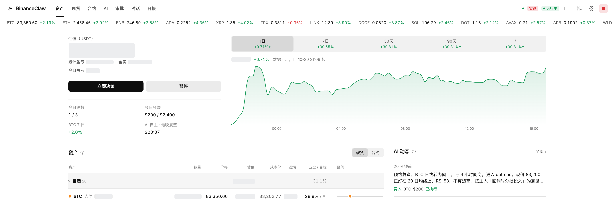
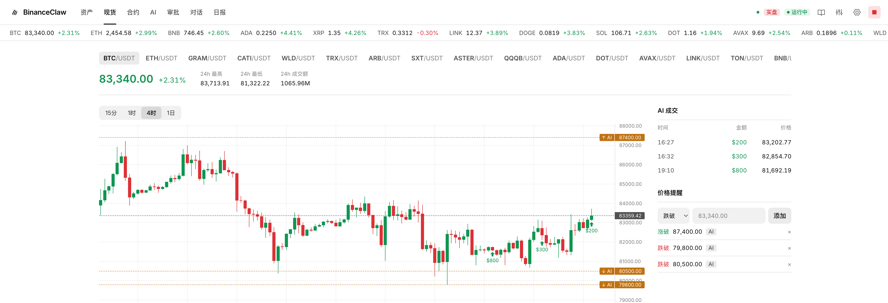

# 界面指南

顶部常驻：

- **行情条**：白名单币种的实时价格和 24 小时涨跌。价格变化时会闪一下绿色或红色。
- **模式标记**：`模拟` 或 `实盘`。实盘时为红色。
- **运行状态**：`运行中` 或 `已暂停`。
- **■ 紧急停止**：暂停自动执行，并作废所有待审批。

## 资产（首页）

- **估值**：AI 管理部分的总值。有锁定资产或未选中的资产时，下方会同时显示账户总值和 AI 管理的部分。
- **估值波动**：估值下方可以切换 1日 / 7日 / 30天 / 90天 / 一年，显示这段时间账户总值的涨跌金额和百分比，以及折线图。估值每 15 分钟记录一次（升级前的决策记录会自动导入）；实盘时还会用币安的每日账户快照补上之前约一个月的历史（只含现货钱包，按当天 BTC 收盘价折算）。还没有记录的区间显示「数据不足」；只有部分记录的区间带 `*`，按最早的一条记录计算。模拟盘和实盘分开记录，重置模拟盘会清空模拟盘的记录。
- **累计盈亏 / 全买 BTC**：只统计 BinanceClaw 自己的成交，按平均成本法计算；「全买 BTC」表示同样的钱在同一时刻都买 BTC 的结果，作为基准。
- **待审批**：AI 提出、金额超过自动执行额度的交易。行内可以直接批准或拒绝，点开能看理由和"判断错了的信号"。详见 [审批](approvals.md)。
- **资产表**：每个币的数量、价格、估值、成本价、浮动盈亏、占比和目标（AI 自主分配时显示「AI」），以及区间条：灰色是允许范围，竖线是目标，圆点是当前位置。锁定的数量和活期理财里的数量会单独标出。币名旁是它在币安的分类；右上角切到「按币安分类」，资产会按币安的分类（Layer 1 / Layer 2、Meme、AI、DeFi……）分组，每组显示合计估值和占比。分类只用于展示，风控区间仍按你的目标配置。
- **AI 动态**：最近几轮决策的结论。点进去能看完整过程。
- **立即决策 / 暂停 / 恢复**：手动触发一轮决策，或暂停、恢复自动执行。

## 现货

- K 线支持 1 小时、4 小时、日线，下方是成交量。
- ▲ 是 BinanceClaw 的买入成交，标"模拟"的是模拟盘成交。
- 右侧「价格提醒」可以设置跌破或涨破某个价位，图上用虚线标出，AI 设置的提醒标「AI」。详见 [Telegram](telegram.md)。
- 下方的 `成交` 和 `审批` 两个标签页列出全部历史。

## 合约

- 顶部是合约权益、占用保证金、未实现和已实现盈亏。
- K 线图上画出开仓价、止损、止盈和估算强平价。
- 持仓表可以「减半」或「平仓」，「全部平仓」会平掉 BinanceClaw 开的所有仓位。
- 下方是历史仓位，以及每次开平仓、止损触发、补挂止损等事件。详见[合约](futures.md)。

## AI

每一轮决策一行，显示时间、模型、结论和动作。点进去分四段：

1. 模型看到的账户快照
2. 模型的判断（含原始输出）
3. 风控逐条检查（每条 ✓ 或 ✗ 及原因）
4. 提示词原文

## 审批

`待处理` 和 `历史` 两个标签。审批在网页和 Telegram 同步，在哪边处理都可以。

## 对话

和当前模型聊账户与行情。它只能读，不能下单。Telegram 里的对话也显示在这里。`新对话` 会清空上下文。

## 日报

每天在设置的时间生成，同时推送到 Telegram，推送里带资产曲线和配置图。

## 设置

模式、模型（含备用模型）、[风险预设](risk-presets.md)、[资产与分配、资金管理](capital-and-allocation.md)、[理财](earn.md)、风控数值、目标配置、节奏、连接状态、已登录设备。改动危险设置时会弹出确认框，见[危险设置要二次确认](decisions-and-risk.md#危险设置要二次确认)。

**外观**：主题可选「跟随系统 / 浅色 / 深色」，默认跟随系统，电脑或手机切换深浅色时页面和 K 线图一起变。选择只保存在当前浏览器。

## 文档

就是你正在看的这些。
